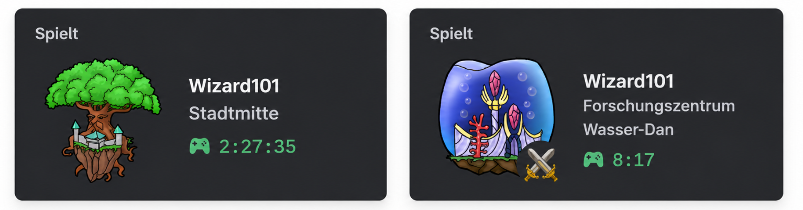
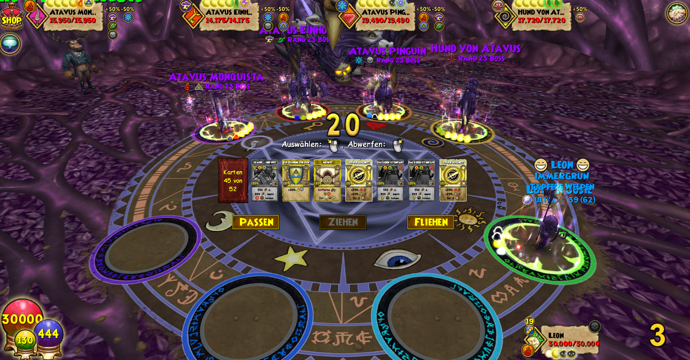
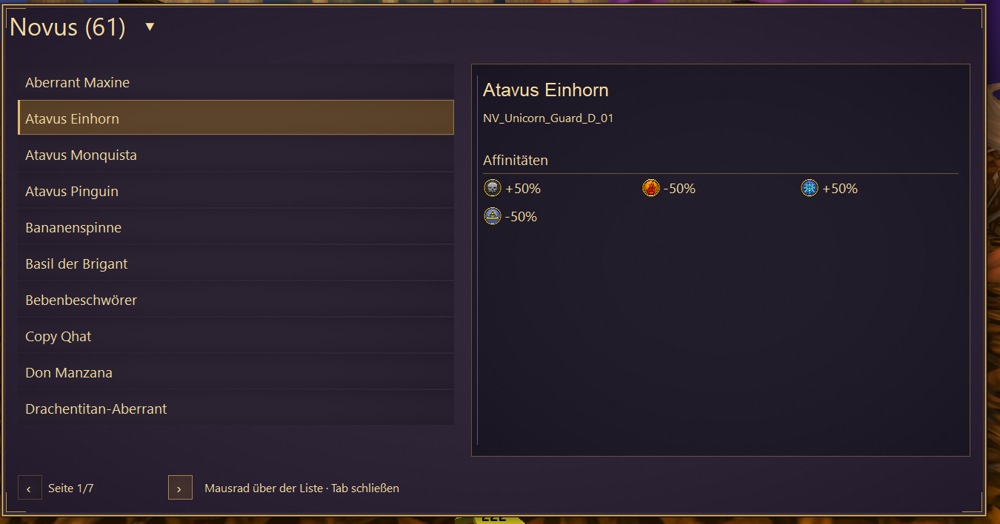

<strong>Meet Corvin, your little companion for Wizard101</strong>

Corvin follows your adventures through the Spiral with Discord Rich Presence, a combat overlay and an in-game bestiary.

 

> **Note:** Currently only available in German.

---

<h2>👀 Preview</h2>

  

---

## ✨ Features

### 🎮 Discord Rich Presence

Corvin automatically reflects your current game state on Discord.

Currently displayed:

- Current world and area
- Roaming or combat status
- Character selection
- World-specific artwork

### ⚔️ Battle Overlay

See the current combat round and known enemy affinities during the planning phase.

  

### 📖 Bestiary

Browse enemies by world and click an entry to view its affinities. Current combat enemies are highlighted and listed first.

Open or close with **Tab**, select a world from the title, and turn pages with the **mouse wheel over the list** or the **page buttons**.

  

---

## 🚧 Planned

- Active buffs and debuffs
- Enemy drop information
- Cheat and mechanic information
- Additional languages

---

## 🖥️ Supported Platforms

- Windows

---

## 🛡️ Windows Security Notice

Corvin is currently **not code signed**.

Because of this, Windows SmartScreen or Microsoft Defender may display a warning when downloading or launching the application.

This does not necessarily indicate that Corvin is malicious — unsigned applications from unknown publishers can trigger these warnings.

The complete source code is available in this repository for transparency.

---

## 🔒 Privacy

Corvin processes Wizard101 log data locally.

Network communication is limited to:

- Discord Rich Presence
- Downloading game data from RavenDex

No user account is required.

---

## 📄 License

MIT License

> Corvin101 is an independent community project and is not affiliated with KingsIsle Entertainment or Wizard101.
